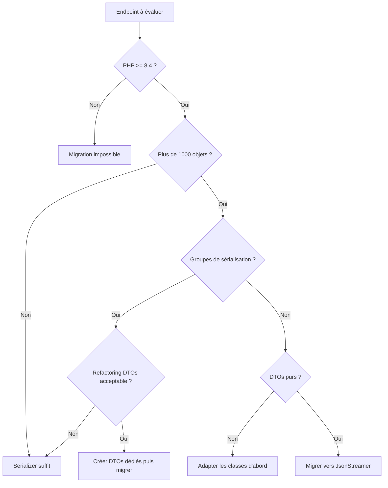

JsonStreamer serializes up to 6x faster. Here is why you cannot just replace your Serializer tomorrow.

The new `symfony/json-streamer` component, introduced in Symfony 7.3 as an **experimental** component, promises massive gains in JSON serialization. But between a benchmark on a simple DTO and your production Symfony application with its normalization groups, custom callbacks, and objects nested three levels deep, there is a gulf.

One important point: Symfony marks the component as experimental. Its API may change between two minor versions with no backward compatibility guarantee. Take this into account before using it in production.

This article answers three questions: is my project eligible? What will I lose? Where do I start?

## What JsonStreamer Really Changes

The [Symfony Serializer](https://symfony.com/doc/current/serializer.html) works through reflection. On every call, it inspects the object, resolves the metadata, applies the normalizers in order, builds an intermediate PHP array, then encodes it to JSON. Everything is in memory, everything is dynamic, everything is flexible.

JsonStreamer takes the opposite approach. At build time (or on the first call), it generates specialized native PHP code for each class. This code produces JSON directly, with no intermediate array, through a PHP generator. It is the difference between printing an entire book before sending it, and sending it page by page as it prints. The recipient starts receiving before the printing is finished.

The official Symfony benchmarks claim gains of up to 10x in time and 98% in memory. We wanted to check. Here is our protocol: a simple DTO (`ProductDto`, five scalar properties and a date), serialized to JSON on collections of 1,000 to 50,000 objects, in a vanilla `php:8.4-cli` Docker container.

| Objects | Serializer (ms) | JsonStreamer (ms) | Time gain | Serializer (MB) | JsonStreamer (MB) | Memory gain |
|--------|-----------------|-------------------|------------|-----------------|-------------------|--------------|
| 1,000 | 17 | 7 | 2.5x | < 1 | < 1 | - |
| 10,000 | 63 | 15 | 4x | 4 | < 1 | > 75% |
| 50,000 | 342 | 54 | 6.3x | 24 | 8 | 67% |

*Measurements on PHP 8.4.8, `php:8.4-cli` Docker container on Windows 11 (WSL2), average of two runs.*

The numbers are below the advertised 10x, but the gain is still significant and grows with volume. On 50,000 objects, the Serializer takes 6 times longer and uses 3 times more memory. On larger collections or more complex objects, the gap widens further.

The full benchmark script is available below so you can reproduce these measurements on your own machine:

```php
<?php

require __DIR__ . '/vendor/autoload.php';

use Symfony\Component\Serializer\Serializer;
use Symfony\Component\Serializer\Encoder\JsonEncoder;
use Symfony\Component\Serializer\Normalizer\ObjectNormalizer;
use Symfony\Component\JsonStreamer\JsonStreamWriter;
use Symfony\Component\JsonStreamer\Attribute\JsonStreamable;
use Symfony\Component\TypeInfo\Type;

#[JsonStreamable]
class ProductDto
{
    public int $id;
    public string $name;
    public float $price;
    public string $category;
    public string $createdAt;
}

function generateProducts(int $count): array
{
    $products = [];
    for ($i = 0; $i < $count; $i++) {
        $dto = new ProductDto();
        $dto->id = $i;
        $dto->name = "Produit $i";
        $dto->price = round(mt_rand(100, 99999) / 100, 2);
        $dto->category = ['PHP', 'Symfony', 'DevOps', 'Cloud'][$i % 4];
        $dto->createdAt = '2026-01-' . str_pad(($i % 28) + 1, 2, '0', STR_PAD_LEFT);
        $products[] = $dto;
    }
    return $products;
}

foreach ([1_000, 10_000, 50_000] as $count) {
    $products = generateProducts($count);

    $serializer = new Serializer([new ObjectNormalizer()], [new JsonEncoder()]);
    memory_reset_peak_usage();
    $start = hrtime(true);
    $serializer->serialize($products, 'json');
    $serMs = round((hrtime(true) - $start) / 1_000_000, 1);
    $serMb = round(memory_get_peak_usage(true) / 1024 / 1024, 1);

    $streamer = JsonStreamWriter::create(streamWritersDir: '/tmp/cache');
    memory_reset_peak_usage();
    $start = hrtime(true);
    foreach ($streamer->write($products, Type::list(Type::object(ProductDto::class))) as $chunk) {}
    $strMs = round((hrtime(true) - $start) / 1_000_000, 1);
    $strMb = round(memory_get_peak_usage(true) / 1024 / 1024, 1);

    echo "$count objets : Serializer {$serMs}ms / {$serMb}MB, ";
    echo "JsonStreamer {$strMs}ms / {$strMb}MB\n";
}
```

To run it on Linux/macOS:

```bash
docker run --rm -v $(pwd):/app -w /app php:8.4-cli \
  bash -c "apt-get update -qq > /dev/null && apt-get install -y -qq unzip git > /dev/null \
  && curl -sS https://getcomposer.org/installer | php -- --quiet \
  && php composer.phar require symfony/serializer symfony/json-streamer symfony/property-access symfony/property-info \
  && php bench.php"
```

On Windows (Git Bash / PowerShell):

```bash
docker run --rm -v "%cd%:/app" -w /app php:8.4-cli bash -c "apt-get update -qq > /dev/null && apt-get install -y -qq unzip git > /dev/null && curl -sS https://getcomposer.org/installer | php -- --quiet && php composer.phar require symfony/serializer symfony/json-streamer symfony/property-access symfony/property-info && php bench.php"
```

## The Prerequisites: A Checklist Before You Start

### PHP 8.4 Required

The component requires PHP 8.4 minimum (`"php": ">=8.4"` in its `composer.json`). There is no workaround.

```bash
php -v | head -1
```

If the output shows PHP 8.2 or 8.3: stop. There is nothing else to read here, so plan your PHP version upgrade first. Our article on [PHP 9.0 and the changes to anticipate](/article/php-9-0-devoile-ce-que-vous-devez-savoir-avant-la-sortie) (in French) can help you plan that path. If you are on 8.4+, we continue.

### Auditing Your Serialized Objects

JsonStreamer only accepts classes with public properties and no logic in the constructor. A pure DTO, typically. The following script scans your `src/` directory and identifies the compatible classes:

```php
<?php

$directory = new RecursiveDirectoryIterator('src/');
$iterator = new RecursiveIteratorIterator($directory);
$phpFiles = new RegexIterator($iterator, '/\.php$/');

foreach ($phpFiles as $file) {
    $content = file_get_contents($file->getPathname());
    if (!preg_match('/class\s+(\w+)/', $content, $matches)) {
        continue;
    }

    $className = $matches[1];
    $issues = [];

    if (preg_match('/function\s+__construct\s*\([^)]+\)/', $content)) {
        $issues[] = 'constructeur avec arguments';
    }

    if (preg_match_all('/\b(private|protected)\s+\$/', $content, $propMatches)) {
        $issues[] = count($propMatches[0]) . ' propriétés non publiques';
    }

    $status = empty($issues) ? 'COMPATIBLE' : 'INCOMPATIBLE';
    $reason = empty($issues) ? '' : ' (' . implode(', ', $issues) . ')';

    echo sprintf("[%s] %s%s\n", $status, $className, $reason);
}
```

On a typical Symfony project, do not be surprised if 70% of your classes are incompatible. That is normal: Doctrine entities, services, and value objects with a constructor are all excluded. Only your pure DTOs are candidates. Note that the changes introduced by [Doctrine ORM 3.0](/article/doctrine-orm-3-0-une-nouvelle-version-majeure-pour-les-bases-de-donnees) (in French) can influence the structure of your entities in this context.

### Inventory of the Serializer Features You Use

Before migrating an endpoint, check which Serializer features it uses. Here is the compatibility matrix:

| Serializer feature | JsonStreamer compatible? |
|---------------------------|--------------------------|
| Normalization groups (`groups`) | No |
| `#[SerializedName]` | Yes, equivalent available |
| Dynamic context | No |
| Custom callbacks | Via ValueTransformer |
| Nested objects | Yes |
| Collections | Yes |
| DateTime | Via ValueTransformer |
| Circular reference handler | Not applicable (no circular references in a DTO) |

If your endpoint uses groups or dynamic context, the migration requires structural refactoring, not just a change of call. A tool like [Rector](/article/rector-et-ses-pouvoirs-maitrisez-levolution-de-votre-code-symfony) (in French) can automate part of these transformations.

## What You Lose, Let's Be Honest

### Serialization Groups

This is the most painful loss. If you have a `User` with `["groups" => ["public"]]` for the public API and `["groups" => ["admin"]]` for the back office, you must create two distinct DTOs: `PublicUserDto` and `AdminUserDto`.

```php
// Avant : un seul objet, deux vues
$json = $serializer->serialize($user, 'json', ['groups' => ['public']]);

// Après : un DTO par vue
$dto = PublicUserDto::fromEntity($user);
$json = $jsonStreamer->serialize($dto);
```

It is more verbose, but architecturally cleaner. Each representation is explicit in the code, not hidden in an annotation. If you work with hexagonal architecture, you probably already have these DTOs: the [migration to hexagonal architecture](/article/migration-symfony-architecture-hexagonale-retour-mission) (in French) is precisely the context where this separation emerges naturally.

### Dynamic Context

No more `$context['datetime_format'] = 'Y-m-d'` on the fly. Everything must be configured statically through `ValueTransformer` classes. For date formats that vary by caller (mobile API vs. web API, for example), this is a problem. The solution: one DTO per format, or a ValueTransformer configurable through a service.

### Compatibility with JMS Serializer

If you use JMS Serializer alongside the native Symfony Serializer, JsonStreamer does not replace it. The two target different uses. JMS remains relevant for its advanced features (versioning, exclusion strategies, virtual properties).

## The Migration Strategy

No big bang. This is the kind of progressive modernization we practice in our [Symfony migration](/migration-symfony) (in French) engagements. The two components coexist without problems in the same Symfony application. The migration goes endpoint by endpoint, starting with the simplest cases and the ones with the biggest performance impact.

### The 3-Question Decision Rule

Before migrating an endpoint, ask yourself these three questions in order:

1. **Does my endpoint return more than 1,000 objects?** If not, the performance gain is negligible, so keep the Serializer.
2. **Do I use serialization groups on this endpoint?** If so, you will need to refactor your DTOs before migrating, so assess the effort.
3. **Are my objects pure DTOs (no constructor with arguments, public properties)?** If so, JsonStreamer is viable right away.



### Coexistence in the Same Project

Both components are injected independently thanks to the [Symfony service container](https://symfony.com/doc/current/service_container.html). You can use the Serializer on 90% of your endpoints and JsonStreamer on the 10% that need it:

```yaml
# config/services.yaml
services:
    _defaults:
        autowire: true
        autoconfigure: true
```

No special configuration is needed. Symfony 7.3 automatically registers the `JsonStreamWriter` service when the component is installed. The two coexist natively.

## Step-by-Step Migration of a Concrete Endpoint

### Before, with the Serializer

A classic controller that exposes a collection of products:

```php
#[Route('/api/products', methods: ['GET'])]
public function list(
    ProductRepository $repository,
    SerializerInterface $serializer,
): JsonResponse {
    $products = $repository->findAll();

    return new JsonResponse(
        $serializer->serialize($products, 'json', [
            'groups' => ['api:product:list'],
        ]),
        json: true,
    );
}
```

This controller loads all products into memory, serializes them into a single JSON block, then returns the response. On 50,000 products, that is 24 MB of RAM and more than 340 ms of waiting.

### After, with JsonStreamer

First, the compatible DTO:

```php
namespace App\Dto;

use Symfony\Component\JsonStreamer\Attribute\JsonStreamable;

#[JsonStreamable]
class ProductDto
{
    public int $id;
    public string $name;
    public float $price;
    public string $category;
    public string $createdAt;

    public static function fromEntity(Product $product): self
    {
        $dto = new self();
        $dto->id = $product->getId();
        $dto->name = $product->getName();
        $dto->price = $product->getPrice();
        $dto->category = $product->getCategory()->getName();
        $dto->createdAt = $product->getCreatedAt()->format('Y-m-d');

        return $dto;
    }
}
```

Then, the migrated controller:

```php
use Symfony\Component\HttpFoundation\StreamedResponse;
use Symfony\Component\JsonStreamer\JsonStreamWriter;
use Symfony\Component\TypeInfo\Type;

#[Route('/api/products', methods: ['GET'])]
public function list(
    ProductRepository $repository,
    JsonStreamWriter $streamWriter,
): StreamedResponse {
    $products = $repository->findAll();
    $dtos = array_map(ProductDto::fromEntity(...), $products);

    $json = $streamWriter->write($dtos, Type::list(Type::object(ProductDto::class)));

    return new StreamedResponse($json);
}
```

The fundamental difference: the JSON is sent to the client in chunks. The browser (or the API client) starts receiving data while the server keeps producing it. Peak memory stays stable regardless of the collection size.

On 50,000 products, we go from ~340 ms to ~54 ms and from ~24 MB to ~8 MB.

## Going Further

- [REST API: best practices](/article/api-rest-les-bonnes-pratiques) (in French), structuring your endpoints before optimizing them
- [Which architecture to choose between microservices and a modular monolith](/article/quelle-architecture-de-projet-choisir-entre-micro-service-ou-monolithe-modulaire) (in French), the architectural context that influences the Serializer vs. JsonStreamer choice
- [Why Docker is essential in production today](/article/pourquoi-docker-est-indispensable-en-production-aujourdhui) (in French), containerizing to control PHP versions
- [Everything about caching](/article/tout-savoir-sur-la-mise-en-cache-tips) (in French), complementing JSON performance with a suitable cache strategy
- [Swagger and NelmioApiDocBundle](/article/swagger-nelmio-bundle-et-ses-fonctionnalites-pourquoi-lutilise-t-on) (in French), documenting your serialized endpoints
- [Streaming JSON: Symfony documentation](https://symfony.com/doc/current/serializer/streaming_json.html), the official reference

JsonStreamer is not the future of the Serializer, it is a specialized tool for a specific problem. If you work at volume, it is unbeatable. If you need view flexibility with groups and dynamic context, keep the Serializer. The two coexist, so use them together. Smart migration goes endpoint by endpoint, starting with the ones where the gain is measurable. This kind of targeted optimization is one of the levers we use in our [custom web development](/developpement-web-sur-mesure) (in French) projects.
